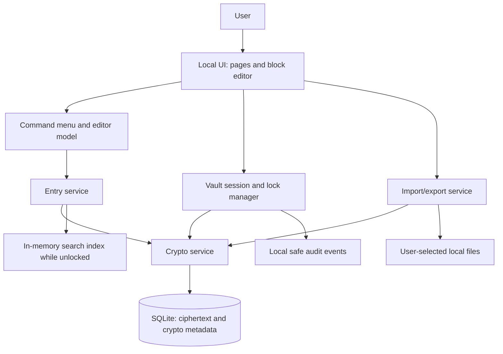

# EnvBook — Product Requirements Document (PRD)

**Document status:** Draft for implementation  
**Version:** 1.0  
**Product name:** EnvBook  
**Product type:** Private developer workspace and encrypted personal vault  
**Primary audience:** Individual developers, students, technical operators, and security practitioners  
**Initial deployment assumption:** Local-first, single-user application. The first release should operate on the user's own computer and bind only to `127.0.0.1`. Self-hosted and cloud synchronization are future options, not MVP requirements.  
**Primary design principle:** Minimal UI, fast capture, live formatted Markdown, and secure handling of secrets.

---

## 1. Executive summary

EnvBook is a lightweight, private workspace for developers to organize project ideas, technical documentation, reusable code, terminal commands, API notes, environment variables, and credentials in one place. It combines the page-and-block editing experience found in tools such as Notion with a security-first credential vault.

Users should be able to create folders and nested pages, type `/` to insert formatted blocks, and see the rendered result immediately rather than constantly viewing raw Markdown. Users must also be able to switch to raw Markdown, import existing `.md` files, and export their notes in portable formats.

Credential storage is a core capability, not an ordinary notes feature. Secrets must be encrypted before they are written to persistent storage, masked by default, and excluded from logs, telemetry, crash reports, and normal exports. The application must never execute a stored credential, shell command, or environment file automatically.

### Product promise

> One private, searchable place for project knowledge and developer secrets, with fast Markdown-style editing and security built in from the beginning.

### Key differentiators

1. A minimal, keyboard-first, block-based editor with Notion-inspired slash commands.
2. One searchable library for ideas, project notes, snippets, API documentation, and structured entries.
3. A dedicated encrypted credential vault with masked reveal/copy controls and explicit `.env` import/export.
4. Local-first operation with no required account, public sharing, collaboration, or cloud dependency in the MVP.
5. Markdown portability to avoid trapping the user's ideas in a proprietary format.

---

## 2. Problem statement

Developers routinely create API keys, database URLs, access tokens, environment configurations, code snippets, project ideas, feature lists, and deployment notes. These are often scattered across `.env` files, unencrypted text files, Markdown notes, browser tabs, chat messages, and repositories. This creates several problems:

- Credentials can be committed to Git or copied into the wrong document.
- Notes and ideas are difficult to find when they are spread across files and applications.
- Plain Markdown is portable but can feel less convenient than a rich, rendered editor.
- Large productivity tools can be heavier than needed for a personal developer workflow.
- A notes app alone does not provide a sufficient security model for secret storage.
- Users need a simple way to organize project knowledge without operating a complex team workspace.

EnvBook addresses these issues with structured pages, a live Markdown/block editor, global search, and a separately defined secrets-handling layer.

---

## 3. Product goals and success criteria

### 3.1 Goals

- Make capture of an idea or note fast enough to happen immediately.
- Support folders, unlimited practical nesting, pages, subpages, tags, favorites, archive, trash, and restore.
- Provide live-formatted editing with slash commands, Markdown shortcuts, code highlighting, and keyboard navigation.
- Store credentials and sensitive entry content encrypted at rest.
- Make secret values hidden by default and revealable/copyable only through explicit actions.
- Make all content easy to search while the vault is unlocked.
- Support Markdown import/export and explicit `.env` import/export.
- Keep the first release simple enough for one developer to maintain.
- Preserve portability and avoid vendor lock-in.

### 3.2 Non-goals for the MVP

- Multi-user collaboration, shared workspaces, comments, and team permissions.
- Public pages, public links, or unauthenticated sharing.
- Cloud sync or hosted accounts.
- Automatically injecting secrets into processes, shells, CI/CD systems, or applications.
- Running or executing terminal commands stored in notes.
- Full replacement for enterprise secrets-management platforms.
- Browser extensions, mobile-native apps, or organization-wide identity management.
- AI processing of notes or secret values.
- Real-time collaborative editing.

These may be evaluated later, but must not expand the MVP without an explicit scope decision.

### 3.3 Success metrics

Measure product usefulness and performance without collecting note content or secret values.

- A user can create and save a note in no more than three primary interactions from the home screen.
- A user can create a folder, nested page, and favorite without consulting documentation.
- Slash-command filtering and selection feels immediate on an ordinary development laptop.
- Search results appear promptly for a personal library with thousands of entries, without sending content to a remote service.
- A locked vault does not expose decrypted content in the application UI.
- Secret values do not appear in application logs, error reports, backups in plaintext, or normal Markdown exports.
- Encrypted backup can be restored successfully in a documented recovery test.
- The application starts and works without internet access in local-only mode.
- All MVP acceptance tests pass before release.

Performance targets should be benchmarked on the supported development machine and documented; do not promise a numerical guarantee until measured.

---

## 4. Target users and use cases

### Primary persona: Individual developer

Needs to store project concepts, API keys, database connection strings, `.env` files, code examples, and deployment notes. Wants quick entry capture and fast search.

### Secondary persona: Student or early-career developer

Needs a learning library for terminal commands, project PRDs, code snippets, API documentation, and setup instructions.

### Secondary persona: Security practitioner

Needs to keep lab notes, testing scope, tool commands, endpoint references, configuration notes, and credentials separated and protected.

### Core user stories

- As a user, I can create a page or folder immediately so I can capture a new idea before I forget it.
- As a user, I can nest pages inside projects so related documentation stays together.
- As a user, I can type `/` and select a content block without memorizing raw Markdown.
- As a user, I can import a Markdown file and continue editing it in the rendered editor.
- As a user, I can store a database URI as a secret rather than in a plain note.
- As a user, I can copy a secret when needed without leaving it permanently visible on screen.
- As a user, I can associate credentials with a project and environment such as development, staging, or production.
- As a user, I can search for entries while the vault is unlocked.
- As a user, I can export my notes as Markdown and make a separate encrypted backup of the entire vault.
- As a user, I can restore a mistakenly deleted page or folder from Trash.
- As a user, I can lock the vault manually or automatically after inactivity.

---

## 5. Product principles

1. **Private by default:** No account, telemetry, public sharing, or external sync is required for the MVP.
2. **Encrypt first:** Sensitive content is encrypted before durable storage; the editor is not a security boundary.
3. **Minimal UI:** Keep the information architecture compact and avoid unnecessary dashboards, animation, and configuration.
4. **Keyboard-first:** Common actions can be completed without a mouse.
5. **Markdown-friendly:** Content must remain portable and exportable.
6. **Safe defaults:** Secrets are masked, exports are explicit, and commands are never executed automatically.
7. **Explainable behavior:** Users should understand what is encrypted, what is exported, and what cannot be recovered if the key is lost.
8. **No silent loss:** Autosave status, import results, archive/delete behavior, and backup status must be visible.
9. **Preserve working behavior:** Future changes must not break previously working features. Keep implementation concise, maintainable, and documented.

---

## 6. Product scope and release phases

### Phase 1 — MVP: Private local-first vault

- Local-only startup and single-user unlock flow.
- Vault encryption and key derivation design.
- Home dashboard, sidebar, folders, nested pages, breadcrumbs, and page actions.
- Rendered block editor and raw Markdown mode.
- Core slash menu and Markdown typing shortcuts.
- Code blocks, lists, checkboxes, callouts, quotes, dividers, links, tables, and table of contents.
- Credentials and environment entries with masked secret fields.
- Tags, favorites, recents, archive, trash, restore, duplicate, move, rename, and sorting.
- Global search over decrypted data while unlocked.
- Autosave, undo/redo, import/export for Markdown and plain text.
- Explicit `.env` import and export.
- Auto-lock, manual lock, clipboard best-effort clearing, and secure error handling.
- Encrypted full-vault backup and verified restore.
- Unit, integration, security, and usability tests.

### Phase 2 — Developer productivity

- Structured entry databases and multiple views.
- Project, PRD, API, environment, code snippet, and command templates.
- More advanced filtering, grouping, saved views, bulk operations, and cross-links.
- Additional code languages and JSON/YAML/SQL/HTTP specialized blocks.
- Version history for notes and deliberate secret-version handling.
- Credential rotation dates and reminders.
- Import of supported archive bundles and richer export options.
- Optional PWA installation and improved offline UX, subject to architecture review.

### Phase 3 — Advanced features

- Optional user-configured self-hosted deployment.
- Optional encrypted multi-device synchronization after a threat model and key-management review.
- Additional custom templates and command registration.
- Optional diagrams, embeds, image/file attachments, and synced blocks.
- Optional desktop packaging if a browser-served local application is not sufficient.
- Carefully scoped AI assistance only if added later; secret fields must be excluded by default and no data may be sent externally without an explicit opt-in.

### Explicitly out of scope until separately approved

- Team access, account recovery by a service operator, public links, credential sharing, and server-side plaintext access.
- Secret autofill into other applications.
- Shell command execution from a note.
- Browser/password-manager extensions.
- General-purpose project management with complex dependencies and automation.

---

## 7. Information architecture

### 7.1 Main navigation

The left sidebar should contain:

- **Home** — overview and quick actions.
- **All Entries** — unified library of all pages and structured records.
- **Projects** — project-oriented entries and related notes.
- **Credentials** — secure secrets library.
- **Environments** — `.env`-style collections by project/environment.
- **Ideas Inbox** — quick-capture entries not yet organized.
- **Code Library** — reusable snippets and commands.
- **Favorites** — pinned pages and records.
- **Recents** — recently opened or modified entries.
- **Archived** — hidden but retained entries.
- **Trash** — deleted items and restore actions.
- **Settings** — vault lock, security, import/export, backup, theme, and editor preferences.

Keep this navigation configurable only where customization adds real value. Avoid a complicated workspace/team hierarchy in the MVP.

### 7.2 Home dashboard

Display:

- New Page, New Folder, New Credential, New Environment, and Quick Capture actions.
- Recently opened entries.
- Recently edited entries.
- Favorites.
- Ideas Inbox count.
- Backup status and last successful backup time, without showing secret values.
- Vault state and a visible lock control.

Do not show secret values or sensitive environment values on the dashboard.

### 7.3 Page and folder hierarchy

- A folder can contain pages and other folders.
- A page can contain child pages and formatted blocks.
- Nested pages must be supported to a practical, tested depth; the data model should not impose an arbitrary shallow limit.
- Sidebar items can expand and collapse.
- Drag-and-drop reordering must update the parent and sort order safely.
- Breadcrumbs show the ancestry of the active page.
- A page can be moved to another folder or to the workspace root.
- Folder deletion must clearly explain whether descendants will be moved to Trash together.
- Circular parent references must be rejected.
- Empty folders are allowed.
- Moving entries must preserve IDs, relations, tags, favorites, and history where supported.

### 7.4 Entry types

1. **Page / Note** — rich text and block content.
2. **Folder** — organizational container.
3. **Idea** — quick capture, status, tags, optional project link.
4. **Project** — objective, problem, stack, architecture, status, tasks, related notes, and links.
5. **Credential** — encrypted username/secret/value and safe metadata.
6. **Environment** — keyed variables associated with a project and environment name.
7. **Code Snippet** — language, source, purpose, tags, and related project.
8. **Command** — command text, platform, explanation, expected output, and safety notes; never automatically executed.
9. **API Reference** — base URL, endpoints, authentication notes, request/response samples, and related credentials by reference only.
10. **Document / PRD** — structured requirements and technical documentation.
11. **Attachment / Link** — supported file reference or URL metadata, subject to content-safety and storage limitations.

A single unified entry model should support a `type` field and type-specific content rather than creating completely separate navigation/storage systems for every category.

---

## 8. Functional requirements: pages, folders, and organization

| ID | Requirement | Priority | Acceptance criteria |
|---|---|---|---|
| ORG-001 | Create a page | P0 | A user can create a blank page from Home, sidebar, or command palette. |
| ORG-002 | Create a folder | P0 | A folder can be created at the root or inside an existing folder, subject to valid parent rules. |
| ORG-003 | Create nested pages | P0 | Pages can be nested under pages or folders and reopened after restart. |
| ORG-004 | Rename page/folder | P0 | Rename persists and references remain valid. |
| ORG-005 | Move item | P0 | User can move a page or folder to another parent or root. Invalid circular moves are rejected. |
| ORG-006 | Drag-and-drop order | P1 | Reordering updates persisted sort order and is keyboard-accessible through an alternative move control. |
| ORG-007 | Expand/collapse sidebar branches | P0 | Each branch can be expanded or collapsed; state may persist as a UI preference. |
| ORG-008 | Breadcrumbs | P0 | Active location shows the current hierarchy and allows navigation to ancestors. |
| ORG-009 | Icons | P1 | Users can assign an icon or emoji to a page/folder. |
| ORG-010 | Favorites | P0 | Users can favorite/unfavorite entries and access them from Favorites. |
| ORG-011 | Recents | P0 | Recently opened and edited items appear in appropriate lists. |
| ORG-012 | Archive | P0 | Archive hides an item from normal views without permanently deleting it. |
| ORG-013 | Trash and restore | P0 | Deleted items can be reviewed and restored; permanent deletion requires explicit confirmation. |
| ORG-014 | Duplicate | P1 | Duplicate creates a new ID and copies supported content and metadata. Credential duplication must warn that another secret copy is being created. |
| ORG-015 | Sorting | P1 | Sort by title, created date, updated date, type, or custom order. |
| ORG-016 | Tags | P0 | Entries support multiple tags and tag-based filtering/search. |
| ORG-017 | Templates | P1 | Users can create an entry from a predefined template. |
| ORG-018 | Bulk operations | P2 | Multi-select supports move, tag, archive, and delete with clear confirmation. |
| ORG-019 | Context menu | P0 | A page context menu exposes relevant actions such as rename, duplicate, move, favorite, archive, and delete. |
| ORG-020 | Quick switcher | P1 | Users can jump to entries by searching names without navigating folders manually. |
| ORG-021 | Empty states | P0 | Empty folder, empty search, empty favorites, and empty trash states guide the next action. |
| ORG-022 | Safe folder deletion | P0 | Deleting a folder clearly explains descendant handling and offers a recoverable Trash operation. |

---

## 9. Functional requirements: editor and block system

### 9.1 Editor behavior

- Render blocks as formatted content in the normal editing experience.
- Provide a switch between **Preview/Rendered Editor** and **Raw Markdown**.
- Editing must preserve headings, lists, inline styles, links, code blocks, tables, and supported embeds during mode switches.
- Typing `/` in an empty block or at the current cursor opens the command picker.
- Typing after `/` filters available commands.
- Arrow keys change selection, Enter inserts the selected block, and Esc closes the menu.
- Commands must insert content at the active cursor position, not append it unexpectedly to the bottom of the page.
- The editor supports undo and redo.
- Blocks can be reordered using drag-and-drop and keyboard-operable controls.
- Supported blocks can be transformed into compatible types without silently discarding content.
- Autosave status must be visible: Saving, Saved, or Save failed.
- On a save failure, retain the unsaved local editor state and provide a retry path.
- Warn about unsaved changes when closing or navigating away only when a change has not been safely retained.
- Do not run commands, HTML, scripts, formulas, or embedded content as code by default.
- Render untrusted content safely and sanitize imported HTML.
- Support copy controls for code blocks without copying surrounding UI text.
- Provide accessible labels, visible focus, and keyboard navigation for the editor and slash menu.

### 9.2 Core text and formatting block inventory

These are proposed EnvBook aliases. Exact names are product-defined; they are not claims that every alias is native to Notion.

| Command | Block / action | Requirement |
|---|---|---|
| `/text` | Paragraph | Insert normal text. |
| `/heading` | Heading | Insert a configurable heading; default to H1 only if clearly indicated in UI. |
| `/h1` | Heading level 1 | Insert H1. |
| `/h2` | Heading level 2 | Insert H2. |
| `/h3` | Heading level 3 | Insert H3. |
| `/bulleted-list` | Unordered list | Insert a bulleted item and support continued list creation. |
| `/numbered-list` | Ordered list | Insert a numbered item and preserve ordering. |
| `/todo` | Checkbox | Insert a checkable task item. |
| `/toggle` | Toggle list/section | Collapse or expand child content. |
| `/quote` | Quote block | Display quoted text separately. |
| `/callout` | Callout | Display a highlighted note with optional icon/tone. |
| `/divider` | Divider | Insert a horizontal separator. |
| `/bold` | Bold formatting | Apply to selection or explain how to select text if no selection exists. |
| `/italic` | Italic formatting | Apply to selection. |
| `/strikethrough` | Strikethrough | Apply to selection. |
| `/inline-code` | Inline code | Apply monospace code formatting. |
| `/link` | Hyperlink | Create or edit a URL link with safe URL validation. |
| `/equation` | Equation | Insert a supported math expression block or explain when rendering is unavailable. |

### 9.3 Developer and technical block inventory

| Command | Block / action | Requirement |
|---|---|---|
| `/code` | Syntax-highlighted code | Language selector, copy button, safe rendering, optional line numbers. |
| `/terminal` | Terminal command | Monospaced command text and optional platform label. Never execute it. |
| `/env` | Environment variables | Structured key/value rows; values stored encrypted. |
| `/credential` | Credential entry | Open the secure credential form; never place a secret into ordinary plaintext page content by default. |
| `/api` | API documentation | Structured endpoint/authentication/request/response fields. |
| `/request` | HTTP request example | Store method, URL, headers, and body; mask or reference secrets. |
| `/response` | HTTP response example | Store status, headers, and example payload. |
| `/json` | JSON block | Validate syntax and pretty-print valid JSON. |
| `/yaml` | YAML block | Preserve formatting and optionally validate syntax. |
| `/sql` | SQL block | Syntax highlighting; no database execution. |
| `/http` | Raw HTTP block | Display request/response text without executing it. |
| `/warning` | Security warning | Visually distinguish important risks or operational warnings. |
| `/note` | Technical note | Add a compact note block. |
| `/output` | Command output | Store expected or observed output separately from the command. |
| `/file` | File attachment | Attach a supported file under size and type restrictions. |
| `/diagram` | Diagram | Embed or render a supported diagram format; not required for MVP. |
| `/table` | Table | Insert a structured table block. |
| `/database` | Entry collection/database | Insert a database or filtered collection view. |

### 9.4 Page, layout, and navigation commands

| Command | Block / action | Requirement |
|---|---|---|
| `/page` | Page | Create a page or link to an existing page. |
| `/folder` | Folder | Create a folder at an appropriate hierarchy location. |
| `/breadcrumb` | Breadcrumb | Insert/display page ancestry where useful. |
| `/toc` | Table of contents | Generate links to supported headings on the page. |
| `/columns` | Columns | Arrange compatible blocks in columns; responsive fallback stacks them. |
| `/image` | Image | Insert supported image from local storage; MVP may limit file types and size. |
| `/video` | Video embed | Future/optional; whitelist supported embed providers and do not autoplay. |
| `/embed` | External embed | Future/optional; restrict to configured providers and protect against unsafe embedded content. |
| `/bookmark` | URL bookmark | Show a safe URL preview without executing page scripts. |
| `/synced-block` | Reusable synced content | Future/optional; clearly disclose linked copies and edit propagation. |
| `/template` | Template | Insert a prebuilt page or block layout. |
| `/date` | Date | Insert a date value. |
| `/tag` | Tag | Assign or insert a tag. |
| `/mention` | Page/item reference | Link to an existing entry. |
| `/button` | Action button | Run only predefined, safe internal actions; never arbitrary shell/code by default. |

### 9.5 Slash menu requirements

- Open at the caret when `/` is typed in a valid editor context.
- Provide live filtering by command name, alias, category, and short description.
- Group results by Text, Lists, Code, Data, Security, and Layout.
- Show icon, command name, alias, one-line description, and shortcut when applicable.
- Support mouse, touch, arrow keys, Enter, and Escape.
- Handle no-results and invalid-context states.
- Avoid disrupting existing text when the picker is dismissed.
- Support aliases such as `/h1` and `/heading` pointing to the same block where appropriate.
- Permit new command definitions to be registered later through a controlled command registry; do not evaluate arbitrary user-supplied JavaScript.
- Keep the picker compact and searchable. Frequently used commands should be ranked sensibly, with no giant command wall by default.
- Show security-sensitive commands such as `/credential` with a secure icon and a clear indication that they create encrypted records, not ordinary text.

### 9.6 Markdown typing shortcuts

Support common Markdown-style typing shortcuts as documented product behavior:

| Input | Result |
|---|---|
| `# Heading` | H1. |
| `## Heading` | H2. |
| `### Heading` | H3. |
| `- Item` | Bulleted list. |
| `1. Item` | Numbered list. |
| `[] ` | Checkbox shortcut if configured; document the exact trigger and avoid unexpected transformations. |
| `> Quote` | Toggle/quote behavior must be chosen explicitly; default to a quote block in EnvBook to avoid ambiguity. |
| `**text**` | Bold. |
| `*text*` | Italic. |
| `` `code` `` | Inline code. |
| `~~text~~` | Strikethrough. |
| Triple backticks | Multiline code block. |
| `/` | Open slash menu. |

Shortcut transformations should occur only when the trigger is unambiguous, preserve the user's text, and be undoable.

### 9.7 Editor keyboard shortcuts

Implement and document a consistent cross-platform shortcut map. Suggested mappings:

- `Ctrl/Cmd + N`: new page.
- `Ctrl/Cmd + K` or `Ctrl/Cmd + P`: open quick switcher/search; resolve collisions consistently.
- `Ctrl/Cmd + F`: search current page or global search according to context.
- `Ctrl/Cmd + Z`: undo.
- `Ctrl/Cmd + Shift + Z` or platform-equivalent: redo.
- `Ctrl/Cmd + B`: bold.
- `Ctrl/Cmd + I`: italic.
- `Ctrl/Cmd + Shift + L`: toggle light/dark theme only if it does not conflict with platform/browser behavior; publish the chosen mapping.
- `Esc`: dismiss menus/dialogs or return to the editor.
- A dedicated lock shortcut: manually lock the vault, configurable and shown in Settings.

The product must not copy Notion's exact keyboard mapping blindly. Keyboard accessibility and conflict-free behavior take precedence.

---

## 10. Templates

Templates should accelerate repeatable work but remain editable by the user.

### 10.1 Project template

- Project name
- Problem statement
- Objective and success criteria
- Tech stack
- Architecture / data flow
- Repository URL
- Environment names
- Related credentials (references only, never copied secret values)
- API references
- Task checklist
- Risks and blockers
- Deployment notes
- Links and tags

### 10.2 PRD template

- Summary
- Problem statement
- Goals and non-goals
- Personas and use cases
- Functional requirements
- Non-functional requirements
- UX flows
- Data model
- Security/privacy considerations
- Acceptance criteria
- Phases and milestones
- Risks and open decisions

### 10.3 Credential template

- Credential name
- Category/provider
- Username/client ID where applicable
- Secret value (encrypted)
- Project reference
- Environment: development/staging/production/custom
- Service URL
- Created/updated date
- Rotation/expiration date
- Notes (sensitivity warning displayed)

### 10.4 Environment template

- Project reference
- Environment name
- Key/value variable rows
- Variable description
- Required/optional indicator
- Secret/non-secret classification
- Last updated date
- Explicit import/export actions

### 10.5 API reference template

- API/service name
- Base URL
- Authentication type
- Credential reference
- Method and endpoint
- Query parameters
- Headers
- Example request
- Example response
- Status/error codes
- Rate limits or usage notes
- Related documentation link

### 10.6 Code snippet template

- Title
- Language
- Purpose
- Code
- Usage example
- Dependencies
- Expected output
- Security considerations
- Project reference
- Tags

### 10.7 Command template

- Command
- Operating system/shell
- Purpose and explanation
- Required permissions
- Expected output
- Side effects / destructive-action warning
- Related documentation

### 10.8 Idea template

- Title
- Problem or opportunity
- Proposed solution
- Target user
- Rough effort
- Status: inbox/considering/planned/in progress/done/archived
- Related project
- Tags
- Next action

---

## 11. Structured entries and database views

Inspired by Notion's database model, each database row is an entry that can open as a full page. EnvBook's database capability can be implemented after basic pages and search are stable.

### 11.1 Properties

Support appropriate properties such as:

- Title
- Type
- Tags
- Project relation
- Status
- Environment
- Created date
- Updated date
- Rotation/expiration date
- Provider or service
- Favorite/archived indicators

Sensitive values must not become ordinary database properties that are displayed in table views by default.

### 11.2 Views

- Table view: spreadsheet-like list.
- List view: compact list.
- Card view: visual project/idea cards.
- Optional board grouping by status in a future release.
- Saved views, such as All Credentials, Production Environments, Ideas Inbox, Code Library, and Recently Updated.
- Configure shown/hidden properties per view.
- Filters by type, tag, project, status, date, and environment.
- Sort by title, creation/modification date, status, or custom order.
- Group by entry type, project, status, or environment where relevant.
- Linked views of the same underlying collection should not duplicate content.

### 11.3 Search

- Global search across titles, note bodies, tags, types, project references, and supported code text while unlocked.
- Search results display title, type, folder/breadcrumb, matched excerpt, and modified date.
- Search can filter by type, tag, project, and environment.
- Provide a current-page search in addition to global search.
- Search should work offline in local-only mode.
- All decrypted search indexes for sensitive content should be ephemeral or protected to the same standard as the vault. Do not write plaintext search indexes to disk by default.
- Locking the vault must clear decrypted index/content from the application's active memory where practical and remove rendered sensitive content from the UI.
- The app must not transmit queries or content to a remote search service in the MVP.

---

## 12. Credential vault and environment management

### 12.1 Credential types

- API keys.
- Database URIs and connection strings.
- Passwords.
- Access tokens and refresh tokens.
- SMTP and email service credentials.
- OAuth client secrets.
- SSH/private keys and certificates only if the file/secret format is explicitly supported and tested.
- Cloud provider credentials.
- Other user-defined secret types.

### 12.2 Credential operations

- Create, read, update, archive, delete, restore, and duplicate credentials.
- Associate a credential with a project, service, and environment.
- Search by non-secret metadata and by decrypted content while unlocked.
- Mask secret values by default.
- Reveal a secret only after an explicit click or keyboard action.
- Re-mask after a short, configurable timeout or when navigating away/locking.
- Copy secret value through an explicit copy action.
- Best-effort clear the clipboard after a configurable interval; clearly explain that other clipboard managers, operating systems, and applications can retain copied content.
- Avoid revealing values in notifications, tooltips, page titles, browser tab titles, logs, crash output, or recent-item previews.
- Provide explicit confirmation before bulk export or operations that create extra copies.
- Never automatically fill browser forms or paste secrets into a terminal.
- Track metadata such as created, modified, last reviewed, rotation date, and expiration date without storing secret values in logs.

### 12.3 Environment manager

- Create named environment groups per project, such as development, staging, test, and production.
- Add, edit, reorder, duplicate, and delete variables.
- Variable names must follow a documented validation policy suitable for `.env` files.
- Values classified as secrets are encrypted; the default should be to treat values as sensitive unless the user explicitly marks them non-secret.
- Import `.env` files with a preview before saving.
- Import must not execute the file or expand shell expressions.
- Warn about duplicate keys, malformed lines, and unsupported syntax.
- Preserve comments and ordering where feasible; document any unsupported `.env` syntax.
- Export requires an explicit action and produces a local file only after confirmation.
- Never overwrite an existing file without confirmation.
- Avoid printing secret values in an import preview or error dialog.
- Compare environments by variable name and indicate missing/changed variables without revealing values by default.
- Permit references to Credential entries rather than duplicating the secret value whenever practical.
- Warn before copying production variables into another environment.

### 12.4 Secret lifecycle

- Set or update a rotation date.
- Track expiration dates where applicable.
- Display overdue rotation indicators without displaying the values.
- Provide reminders only within the local application in the MVP; no background service is required.
- Secret version history must not retain unnecessary plaintext values. Historical values, if retained, must be encrypted under the vault key and be subject to explicit retention/deletion controls.
- Deletion must explain whether backups or retained versions include the encrypted historical record.

---

## 13. Security and privacy requirements

Security is a release gate. A sign-in screen or encrypted database file alone is insufficient.

### 13.1 Threat model

Assets:

- API keys, database credentials, passwords, tokens, SSH/private keys, and environment variables.
- Project notes and ideas that may themselves contain sensitive information.
- Encryption keys and recovery material.
- Encrypted backups and exported files.
- Search indexes, clipboard contents, application logs, caches, and crash reports.

Threats:

- Theft of the database or backup file.
- Unauthorized access to an unlocked local session.
- XSS or unsafe Markdown/HTML importing content that can read decrypted data.
- Secrets leaking through logs, error messages, telemetry, screenshots, exports, search indexes, or recent-item previews.
- Weak passphrase/key derivation, nonce reuse, or incorrect cryptographic handling.
- Malicious browser tabs or local processes interacting with an exposed local web service.
- Accidental overwrite, deletion, or loss of the only encryption key.
- Malicious or malformed imported files.
- Dependency compromise or unsafe update process.
- Future synchronization accidentally exposing plaintext to a server.

### 13.2 Local-first network posture

- The MVP should bind to loopback (`127.0.0.1`) only by default, not all network interfaces.
- Do not expose a LAN-accessible server unless the user deliberately enables a separately designed self-hosted mode.
- Protect state-changing requests against CSRF if cookie-based sessions are used.
- Apply strict origin checking and a restrictive Content Security Policy appropriate for the app.
- Prevent arbitrary cross-origin sites from calling privileged local endpoints.
- Avoid unauthenticated local APIs that can export or decrypt vault contents.
- Do not add remote telemetry or analytics by default.
- Do not fetch remote scripts or render arbitrary external HTML in the privileged editor.
- Provide a clear indication that the application is local-only and whether network features are disabled.

### 13.3 Encryption requirements

- Use a well-reviewed cryptographic library; do not implement cryptographic primitives manually.
- Use authenticated encryption such as AES-256-GCM or another reviewed AEAD scheme supported by the selected platform.
- Generate a unique nonce/IV for each encryption operation according to the algorithm/library requirements; never reuse an AES-GCM nonce with the same key.
- Derive an encryption key from the user's vault passphrase using Argon2id with parameters chosen for the supported environment and calibrated through testing. Store the salt and required non-secret KDF parameters, not the passphrase.
- Separate the passphrase verifier/authentication design from key derivation so authentication metadata cannot be used to decrypt secrets without the proper key.
- Keep plaintext master keys and derived keys out of persistent storage, logs, URLs, and browser local storage.
- Keep keys in memory only while the vault is unlocked where architecture permits; clear key references and sensitive UI state on lock, logout, or application shutdown to the extent possible.
- Encrypt sensitive content before it reaches SQLite or other durable storage.
- Encrypt page bodies and sensitive metadata by default. If some metadata remains plaintext for navigation, document exactly what leaks and provide a privacy-preserving design decision.
- Store versioned encryption metadata so the format can be upgraded safely.
- Authenticate record identity/context as associated data where supported to reduce record-swapping risks.
- Use constant-time comparisons where relevant and rely on library-reviewed implementations.
- Implement a safe crypto-format migration before changing algorithms or key derivation parameters.
- Do not claim that clearing memory guarantees forensic erasure; describe it as best effort.

### 13.4 Encryption scope and search trade-off

Recommended default: encrypt user-generated content, including note bodies and sensitive titles, at rest. Non-content database fields needed for database integrity—such as random record IDs, schema version, salt/KDF metadata, nonce, ciphertext, and limited timestamps—may remain available to the application. If titles, tags, or hierarchy names remain plaintext, the PRD and UI must disclose that metadata leakage. Prefer encrypted titles/tags with search performed only after unlock and an in-memory index for the MVP.

### 13.5 Authentication and lock behavior

- First-run setup requires the user to create a strong vault passphrase.
- The vault must not include a hardcoded default password or recovery secret.
- Unlock attempts should have reasonable throttling and avoid leaking whether a particular secret exists.
- Manual lock must immediately remove decrypted views from the UI.
- Automatic lock must be configurable, with a sensible default inactivity interval.
- Lock when the application is closed; do not restore decrypted pages automatically on next launch.
- The user can change the passphrase through an authenticated re-key process that does not expose plaintext to logs or disk.
- Clearly explain that losing the passphrase/recovery material can make data unrecoverable if no valid recovery mechanism exists.
- Do not implement a provider-side password-reset path that bypasses encryption.

### 13.6 Secure application behavior

- Escape text and sanitize imported HTML; disallow arbitrary script execution in page content.
- Avoid unsafe DOM insertion APIs for untrusted content.
- Restrict URL protocols to safe schemes; reject `javascript:` and other unsafe schemes.
- Use parameterized SQL statements and validate input on every persistence boundary.
- Validate uploaded file type, size, filename, and storage destination.
- Protect against path traversal during import/export.
- Use safe error messages that omit secrets, file contents, and encryption key material.
- Do not log request bodies for credential, environment, import, export, unlock, or decrypt operations.
- No secret values in analytics or telemetry. MVP telemetry should be off by default.
- Avoid storing decrypted data in browser `localStorage`, IndexedDB, service-worker caches, or persistent caches unless the architecture explicitly encrypts and tests that storage.
- If using a browser UI with an Express backend, use strict CSP, secure cookie settings where applicable, origin checks, and no arbitrary localhost API access.
- Pin and update dependencies, maintain a software bill of materials where practical, and scan dependencies for known vulnerabilities.
- Backups must be encrypted and restore-tested.
- Export files intentionally generated as plaintext must be clearly marked and handled with a deliberate user action.

### 13.7 Backups, recovery, and deletion

- Create an encrypted full-vault backup that includes required metadata and encrypted records.
- Provide restore validation before replacing current data.
- Never overwrite the active vault until the backup has been validated and the user has confirmed replacement/merge behavior.
- Test that restore works on a clean installation.
- Clearly disclose that a lost passphrase can make encrypted backups unrecoverable.
- Provide optional export of ordinary notes to Markdown separately from encrypted vault backup.
- Normal Markdown export must exclude credentials and secret values by default.
- If the user explicitly exports sensitive content, show a high-visibility confirmation and specify the target path and file type.
- Trash deletion is reversible; permanent deletion requires confirmation.
- Clarify that deleting an item from the active database does not automatically erase copies present in old backups.

### 13.8 Security acceptance gates

The MVP cannot be considered complete until tests confirm:

- A copied database file does not reveal plaintext secret values or protected page content.
- Invalid authentication cannot access decrypted records.
- Locking removes content from the visible UI and blocks further operations until unlock.
- Secret values are absent from application logs and test-generated crash output.
- Malicious HTML/Markdown imports cannot execute script in the application context.
- Cross-origin requests cannot invoke privileged localhost actions.
- Export operations do not include secrets unless explicitly requested and confirmed.
- Backup and restore preserve confidentiality and data integrity.
- Cryptographic nonces are generated correctly and not reused under the same key.
- The application does not bind to non-loopback interfaces by default.

---

## 14. Data model (conceptual)

Implementation can use SQLite for local-first persistence. The exact ORM/schema can be chosen during implementation, but the relationships and security properties below are required.

### 14.1 `VaultMetadata`

- `vault_id`: random unique identifier.
- `schema_version`: database schema version.
- `crypto_version`: encryption format version.
- `kdf_algorithm`: e.g., Argon2id.
- `kdf_salt`: random salt.
- `kdf_parameters`: non-secret parameters.
- `created_at`, `last_unlocked_at`: minimal timestamps as needed.
- No stored plaintext passphrase or reusable plaintext encryption key.

### 14.2 `Entry`

- `id`: random identifier.
- `type`: page, folder, idea, project, credential, environment, snippet, command, API reference, document, or attachment/link.
- `parent_id`: optional reference to a parent entry.
- `sort_order`: ordering value.
- `encrypted_payload`: authenticated ciphertext containing title/body/type-specific data and sensitive metadata, per the chosen encryption model.
- `nonce`: per-encryption nonce/IV.
- `crypto_version`: record encryption format version.
- `created_at`, `updated_at`: timestamps; consider metadata privacy trade-offs.
- `archived_at`, `deleted_at`: tombstone metadata as required.
- `is_favorite`: either encrypted payload or limited metadata with a disclosed privacy trade-off.

The final implementation must prevent cycles in `parent_id`, validate relations, and define cascading semantics for folder/page deletion.

### 14.3 `Tag`

- `id`: random identifier.
- `encrypted_name` or name included in encrypted entry payload, based on search design.
- Relations to entries through a join table or encrypted relation data.

### 14.4 `EntryTag`

- `entry_id`, `tag_id` relation.
- If the relation reveals sensitive metadata, encrypt or disclose the leakage.

### 14.5 `Template`

- `id`, name, entry type, encrypted template content, created/updated date.
- Templates must never include real production credentials by default.

### 14.6 `ViewDefinition`

- `id`, name, source collection/type, filter, sort, group configuration, visible properties.
- Persisted query definitions must be validated; do not evaluate arbitrary JavaScript or SQL from a saved view.

### 14.7 `VaultEvent`

- Event ID, event type, timestamp, safe metadata.
- Events may include unlock failure, lock, create/update/delete, reveal, copy, import/export, backup, and restore.
- Do not record secret values, complete notes, request bodies, passphrases, derived keys, or plaintext environment files.
- Local audit events should be protected from accidental disclosure and have documented retention behavior.

### 14.8 Data handling requirements

- All record IDs should be non-predictable identifiers.
- Use database constraints and transactions for move/delete/restore operations.
- Use schema migrations with backup and rollback strategy.
- Validate type-specific payloads.
- Keep search index data in memory while unlocked unless a separately reviewed encrypted index is implemented.
- Avoid plaintext full-text search indexes on disk.
- Large attachments may require a separate encrypted file store with authenticated metadata; do not silently store them unencrypted.

---

## 15. Technical architecture

### 15.1 Recommended MVP stack

- **Runtime/backend:** Node.js with Express.js for the local application service.
- **Frontend:** HTML, CSS, JavaScript; keep the initial UI framework-free unless complexity proves otherwise.
- **Persistence:** SQLite for a single-user local-first installation.
- **Editor:** A maintained block-editor library with Markdown import/export and slash-command support, or a lightweight editor such as CodeMirror for raw Markdown mode paired with a rendered block editor.
- **Code highlighting:** A maintained syntax-highlighting library with languages enabled intentionally.
- **Crypto:** A reputable library that supports Argon2id and authenticated encryption on the chosen platform.
- **Validation:** A schema validation library for request and entry payloads.
- **Testing:** Unit tests, API/integration tests, editor interaction tests, and security regression tests.

Do not add MongoDB to the MVP solely because it is common in web stacks. SQLite better matches a lightweight, local, single-user vault. A future self-hosted/cloud edition can revisit the persistence layer after its access-control and key-management model is defined.

### 15.2 Architecture diagram

### 15.3 Architecture rules

- Separate UI/editor logic, entry services, cryptographic operations, persistence, and import/export.
- Treat storage, imported files, URLs, and editor content as untrusted inputs.
- Only the crypto service may encrypt/decrypt protected payloads.
- Do not write plaintext protected payloads through a generic persistence helper.
- Keep credentials as structured encrypted records or secure blocks; do not serialize them into ordinary notes by default.
- Do not make the UI the only layer enforcing authorization/lock state.
- Keep command definitions declarative; do not evaluate arbitrary user script to implement a slash command.
- Keep configuration explicit and avoid unnecessary environment variables containing master keys.
- Document important logic and data flow with useful comments, not excessive boilerplate.
- Preserve all existing working features when modifying the implementation.

### 15.4 Application configuration

- Default listening address: `127.0.0.1`.
- Default mode: local-only; network sync disabled.
- Database path and backup path must be clear and configurable.
- Avoid storing encryption keys or passphrases in `.env` or config files.
- Do not include real API keys or production credentials in example configuration.
- Provide a safe first-run configuration flow and explain local data storage location.

---

## 16. Import and export

### 16.1 Markdown/plain-text import

- Support `.md`, `.markdown`, and `.txt` in MVP.
- Parse Markdown into supported blocks while retaining source content where possible.
- Provide an import preview with filename, size, title, detected headings, and unsupported features.
- Sanitize HTML and unsafe links.
- Warn if the document appears to contain credential-like content and ask whether to import as a standard note or review it for secret fields. Detection is a warning, not a guarantee.
- Import must not overwrite existing entries silently.
- Report per-file success/failure for multi-file imports.
- Handle invalid encoding and oversized files gracefully.

### 16.2 Markdown export

- Export one page or a selected folder/tree.
- Preserve headings, lists, quotes, code fences, tables where supported, and links.
- Export attachments through a documented companion-assets folder or supported package format.
- Normal export excludes Credential and Environment secret values by default.
- Offer a separate explicit option for sensitive export only if needed, with strong confirmation and clear file destination.
- Do not include internal encryption metadata, session tokens, or vault keys in Markdown exports.

### 16.3 `.env` import/export

- Require explicit selection of the source file and display a safe preview.
- Do not evaluate variable interpolation, shell substitutions, or executable content.
- Validate and report duplicate keys, invalid identifiers, unsupported syntax, and comments handling.
- Treat values as sensitive by default.
- Export to a user-selected location; ask before overwrite; never export automatically at startup.
- Never include values in error telemetry or logs.

### 16.4 Encrypted backup and restore

- Backup includes all needed encrypted records and metadata to restore the vault.
- Backups are authenticated/encrypted using a documented scheme and unique nonces.
- Backup format includes a format version and validation mechanism.
- Restore first validates integrity, version compatibility, and passphrase access.
- Offer replace or safe restore-to-new-vault behavior; do not overwrite the active vault by default.
- Display summary counts without displaying any secret values.
- Add recovery documentation and test clean-install restore.

---

## 17. UX and visual design requirements

### 17.1 Visual identity

- Minimal, distraction-free layout.
- Default light/dark themes; initial visual direction can be black/white with restrained green accent for security status.
- Neutral surfaces and thin separators; avoid excessive cards and colored badges.
- Clear typography hierarchy for page titles, headings, metadata, and code.
- Responsive layout for common laptop/desktop sizes; mobile behavior should remain readable even if mobile-native optimization is not an MVP target.
- Code blocks must have adequate contrast and horizontal scrolling where required.

### 17.2 Main layout

- Collapsible left sidebar.
- Main editor canvas.
- Page header with title, icon, breadcrumbs, favorite, last-saved status, and contextual actions.
- Optional right-side table of contents or page information panel on wider screens.
- Search/quick-switcher overlay.
- Slash-command picker anchored near the caret.
- Secure credential editor that uses a distinct icon and clear masking indicators.

### 17.3 Interaction principles

- One-click quick capture from Home.
- Keyboard-first operation.
- Clear hover/focus/selected states.
- Confirm destructive or sensitive actions, not every routine action.
- No surprising format changes from shortcuts.
- Autosave with visible status and retry.
- Dialogs display meaningful action names and target entry titles without exposing secret values.
- Secret reveal/copy controls should be near the field, with mask state obvious.
- Empty states should show the next useful action.
- Never rely on color alone to communicate locked, saved, failed, expired, or overdue status.

### 17.4 Accessibility

- Keyboard access for all essential functions.
- Visible focus outlines.
- Semantic headings and accessible labels.
- Screen-reader names for icon-only buttons.
- Sufficient contrast in both themes.
- ARIA-live save/error announcements when useful.
- Focus trapping and return focus for modal dialogs.
- Reduced-motion support where applicable.

---

## 18. Non-functional requirements

### Performance

- Fast cold start and unlock on supported hardware; measure rather than assume exact timings.
- Smooth editing for typical notes and code snippets.
- Lazy-load large pages and long lists where needed.
- Avoid rendering every entry in a large sidebar at once.
- Search must not require network calls in local mode.
- Do not decrypt the entire vault unnecessarily for one page open; optimize after correctness and crypto review.

### Reliability

- Atomic writes or transactions for critical changes.
- Recover gracefully from a process crash during save/import/restore.
- Keep a prior backup or recovery point before migration and restore operations.
- Detect corrupt or unsupported database/backup formats and fail safely.
- Show clear, non-sensitive error messages.

### Privacy

- Local-only means no required remote account or content upload.
- No analytics by default.
- No content/secret collection in diagnostics.
- Document metadata leakage, encrypted fields, export behavior, and backup retention.
- Do not insert credentials into ordinary note content without an explicit user action.

### Maintainability

- Use modules with clear responsibilities.
- Keep command definitions and templates declarative.
- Use schema validation and typed/structured internal models where possible.
- Document crypto boundaries, storage format, key lifecycle, data migrations, and backup restore.
- Add regression tests before changing security-critical code.
- Avoid overengineering and unnecessary dependencies.

### Portability

- Markdown import/export is required.
- The database/backup format must have a version field.
- A user should be able to export their non-secret documentation without relying on a proprietary server.
- Encrypted full-vault backup must be distinguishable from ordinary Markdown exports.

---

## 19. Error, edge, and recovery cases

- Wrong vault passphrase: show a generic unlock failure; do not reveal protected content.
- Lost passphrase: show the documented recovery limitation; no backdoor recovery.
- Save failure: retain current edits in memory and offer retry; do not claim saved.
- Disk full: stop unsafe writes, explain the problem, and preserve recoverable data where possible.
- Corrupt database: prevent silent overwrite; guide user to restore or create a copy for recovery.
- Import with malformed Markdown: import recoverable content and report unsupported structures.
- Import with potential secrets: warn and allow the user to cancel or review.
- Duplicate `.env` keys: show conflicts and require a choice or apply a clearly documented policy.
- Export destination already exists: ask before overwrite.
- Folder move would create a cycle: reject without changing the tree.
- Delete parent folder: display descendant count and explain what enters Trash.
- Secret copy: perform only on explicit action and show a discreet confirmation without showing the value.
- Auto-lock while editing: preserve encrypted/safely retained unsaved work or require save before lock; never write plaintext recovery files.
- Unsupported encryption/backup version: fail closed and preserve source data.
- Large page or attachment: warn or process incrementally to prevent UI freeze.
- Unsupported browser/editor shortcut: provide an accessible fallback menu.
- Imported malicious HTML or URL: sanitize/reject unsafe content.
- External embed unavailable: retain safe URL metadata and do not compromise the app.

---

## 20. Analytics and telemetry policy

- Default telemetry: disabled.
- Do not collect page titles, note bodies, code, environment keys/values, credentials, search queries, file names, local paths, or clipboard contents.
- If anonymous usage statistics are ever introduced, require explicit opt-in and document each event field.
- Local audit history is different from telemetry and must remain local in the MVP.
- Error reports must be scrubbed of application state and user content before being shown or exported.

---

## 21. Testing and quality plan

### Unit tests

- Entry creation, update, move, duplicate, archive, delete, restore, and tree-cycle rejection.
- Markdown parsing/rendering and safe transformations.
- Slash menu filtering, selection, insertion point, dismissal, aliases, and keyboard operation.
- Template validation and expansion.
- `.env` parsing, duplicate-key handling, and safe export generation.
- Crypto service input validation, serialization, metadata versioning, and authentication failure paths.
- Search filters and in-memory index behavior.

### Integration tests

- Lock/unlock workflow.
- Encrypted persistence round-trip.
- Full-vault backup/restore on a clean installation.
- Markdown import and export with representative content.
- Credential creation, masking, reveal, copy, update, archive, delete, and restore.
- Nested page/folder lifecycle and breadcrumbs.
- Autosave and recovery after simulated failures.
- No remote requests in local-only mode.

### Security tests

- Inspect database and backup files to confirm sensitive content is encrypted.
- Verify no plaintext appears in application logs, stack traces, browser console output, or generated diagnostic files.
- Test CSP and sanitization with script tags, event handlers, unsafe URLs, malformed Markdown, and malicious imports.
- Test cross-origin requests against local endpoints.
- Verify service binds to loopback only.
- Verify unlock throttling and lock state enforcement.
- Verify clipboard timer is best-effort and no copy occurs without explicit interaction.
- Verify no secrets appear in normal Markdown export or search result excerpts when locked.
- Verify cryptographic nonce uniqueness and AEAD integrity checks.
- Test database migrations, corrupted backups, wrong passphrases, and unsupported format versions.
- Scan dependencies and test third-party editor/plugin behavior.

### Usability tests

- First-run setup and unlock.
- Capture an idea from Home.
- Create and nest pages/folders.
- Use at least ten slash commands with mouse and keyboard.
- Switch between rendered and raw Markdown without content loss.
- Find a page using global search and Quick Switcher.
- Add and export environment variables without accidental display.
- Backup and restore a vault.
- Lock and verify the screen no longer displays decrypted content.

---

## 22. MVP acceptance checklist

### Navigation and pages

- [ ] Create, rename, nest, move, reorder, favorite, duplicate, archive, delete, restore, and permanently delete pages/folders.
- [ ] Expand/collapse the sidebar and use breadcrumbs.
- [ ] Search by supported content when unlocked.
- [ ] Show recent entries and favorites.
- [ ] Prevent invalid parent cycles and preserve hierarchy after restart.

### Editor

- [ ] Render formatted Markdown content.
- [ ] Switch between rendered and source modes.
- [ ] Open slash menu with `/` and filter commands.
- [ ] Implement all P0 core text and developer commands listed in this PRD.
- [ ] Support heading, list, checkbox, quote, callout, divider, link, inline code, and fenced code shortcuts.
- [ ] Provide syntax highlighting and code copy controls.
- [ ] Support undo/redo and safe block transformation.
- [ ] Display save status and recover from save failure.
- [ ] Sanitize imported or pasted HTML.

### Credentials and environments

- [ ] Create and edit credential records with encrypted values.
- [ ] Mask by default and reveal only on explicit user action.
- [ ] Copy only after explicit user action and avoid logging the value.
- [ ] Associate credentials with projects and environments.
- [ ] Import and export `.env` files with preview, validation, and confirmation.
- [ ] Do not expose secret values in ordinary Markdown export by default.
- [ ] Provide rotation/expiration metadata, even if reminder automation is deferred.

### Security and recovery

- [ ] Strong first-run passphrase setup; no default credential.
- [ ] Key derivation and authenticated encryption implemented using reviewed libraries.
- [ ] No plaintext protected payloads in persistent storage.
- [ ] Manual and inactivity-based lock.
- [ ] No remote sync/telemetry by default.
- [ ] Local service binds to loopback.
- [ ] Encrypted backup and tested restore.
- [ ] Logs and errors do not contain secrets.
- [ ] Document passphrase loss and backup recovery limitations.

### Quality

- [ ] Unit, integration, security, and usability tests pass.
- [ ] All primary flows work offline.
- [ ] Empty, loading, error, locked, and no-search-result states are implemented.
- [ ] Keyboard navigation and visible focus are supported.
- [ ] No existing functionality is broken by follow-on changes.

---

## 23. Risks and mitigations

| Risk | Impact | Mitigation |
|---|---|---|
| Weak or incorrectly implemented cryptography | Vault compromise | Use reviewed libraries, versioned format, security tests, and expert code review before release. |
| User forgets passphrase | Permanent data loss | Clear warning during setup, encrypted backups, documented recovery limitations. No hidden backdoor. |
| Secrets copied into normal notes | Accidental leakage through exports | Separate credential records, secret detection warning, export exclusions by default. |
| Search index leaks content | Sensitive notes exposed while locked or in files | Build index in memory while unlocked and clear it on lock. |
| Browser/local endpoint abuse | Unauthorized vault actions | Bind to loopback, enforce origin/CSRF protection, restrictive CSP, and require unlocked state for privileged operations. |
| Scope grows toward a full Notion clone | Delays and complexity | Maintain P0/P1/P2 priorities; ship local-first MVP before databases, embeds, and sync. |
| Editor library creates lock-in | Migration cost | Isolate editor model and support Markdown import/export; test format round-trips. |
| Backup contains old deleted secrets | Retention risk | Document retention, allow encrypted backup replacement/deletion, and avoid claiming active deletion erases existing backups. |
| Clipboard remains accessible | Secret exposure | Explicit copy action, best-effort clearing, short reveal duration, visible warning. |
| Untrusted embeds/HTML | XSS/data exfiltration | Sanitize content, restrict providers, avoid arbitrary scripts, use CSP, and test malicious input. |
| Local storage corruption | Data loss | Transactions, backups, validated restore, and no destructive automatic migrations. |
| Overuse of external packages | Attack surface | Keep dependency count low, pin and audit dependencies, remove unused packages. |

---

## 24. Open decisions for implementation

These decisions should be recorded before coding the relevant component. The defaults below keep the MVP small.

| Decision | Recommended default |
|---|---|
| Deployment | Local-only, single-user, loopback-bound application. |
| Persistence | SQLite. |
| Frontend framework | Plain HTML/CSS/JavaScript initially; add a framework only if editor complexity justifies it. |
| Editor strategy | Maintained block editor with custom slash registry plus raw Markdown mode. |
| Encryption scope | Encrypt page content and sensitive metadata by default; disclose any plaintext metadata. |
| Search | Decrypt/index only while unlocked; in-memory index. |
| Secret defaults | Treat environment values as sensitive unless marked otherwise. |
| Cloud sync | Out of MVP. Revisit only after key management/threat model. |
| File attachments | Limited support in a later phase; define encryption, file-size, and extension policies first. |
| Videos/embeds/synced blocks | Optional future features with provider allowlists and a clear security model. |
| AI | Out of MVP. No secret content sent to external providers. |
| Export | Markdown exports exclude credentials by default; full vault uses encrypted backup. |
| Recovery | No master-password bypass; recovery relies on user-controlled valid recovery material/backup if implemented. |

---

## 25. Recommended implementation sequence

1. Establish repository structure, app startup, local-only binding, lint/test setup, and a secure configuration baseline.
2. Implement vault setup, key derivation, crypto service, encrypted persistence, lock/unlock, and encrypted backup/restore tests before adding secrets to the UI.
3. Implement the entry tree, folders, pages, breadcrumbs, trash, archive, favorites, and safe CRUD operations.
4. Add the editor shell, raw Markdown mode, rendered blocks, autosave, undo/redo, and the command registry.
5. Add the slash picker and implement the P0 command list plus Markdown shortcuts.
6. Implement secure credential and environment records, masked fields, reveal/copy actions, and `.env` import/export.
7. Add search, tags, recents, templates, and project relations.
8. Add import/export workflows and confirm that normal Markdown export does not leak secret fields.
9. Run the security test plan, assess library/dependency risks, and test backup recovery.
10. Polish accessibility, keyboard workflows, empty/error states, performance, and documentation.
11. Only after MVP acceptance, implement structured database views, rotation reminders, PWA/desktop packaging, or optional synchronization.

**Important sequencing rule:** Do not build the credential screens using plaintext persistence as a temporary shortcut. Encryption boundaries and secret redaction must be in place before storing real credentials.

---

## 26. Required project documentation and deliverables

The repository should include:

- `PRD.md` — this product requirements document.
- `README.md` — purpose, features, setup, run instructions, storage location, and limitations.
- `SECURITY.md` — threat model, data flows, crypto design, vulnerability reporting procedure, and security test checklist.
- `ARCHITECTURE.md` — module responsibilities, storage design, crypto boundaries, and data flow.
- `DATA_FORMAT.md` — encrypted record/backup format versions and migration policy, without exposing keys.
- `BACKUP_AND_RECOVERY.md` — backup, restore, passphrase-loss, and deletion behavior.
- `CONTRIBUTING.md` — coding conventions and test instructions if contributions are enabled.
- `.env.example` — configuration placeholders only; never real credentials or master keys.
- Unit, integration, and security test suites.

Documentation must explain what the code does, why it exists, how the logic/data flow works, and how modules connect. Comments should be meaningful and concise.

---

## 27. Definition of done

EnvBook MVP is done when:

1. All P0 requirements and MVP acceptance items are implemented and tested.
2. The app starts locally and does not expose a network listener beyond loopback by default.
3. Users can create and organize notes/pages, use slash commands, and move between rendered Markdown and source mode without losing supported content.
4. Credential and environment values are encrypted at rest, masked by default, and excluded from ordinary exports and logs.
5. The application locks reliably and does not reopen directly into decrypted content.
6. Encrypted backup restore works on a clean installation and is documented.
7. Import/export, errors, empty states, accessibility, and recovery paths are covered.
8. Security tests for encryption, XSS/sanitization, local endpoint exposure, logs, exports, and lock enforcement pass.
9. No feature is described as implemented unless it has working code and tests.
10. A release checklist records known limitations and any deferred requirements.

---

## 28. Official reference documentation

The following sources informed the Notion-inspired interaction model and security requirements. EnvBook's slash-command names and scope remain product decisions rather than a claim of exact Notion parity.

### Notion — editor and organization

- [What is a block?](https://www.notion.com/help/what-is-a-block) — block-based page content, slash menu, transforming and rearranging blocks.
- [Navigate with the sidebar](https://www.notion.com/help/navigate-with-the-sidebar) — nested pages, collapsible structure, drag-and-drop, favorites, recents, templates, and Trash.
- [Keyboard shortcuts](https://www.notion.com/help/keyboard-shortcuts) — keyboard-first navigation and Markdown-style shortcuts.
- [Code blocks](https://www.notion.com/help/code-blocks) — code language selection and code block behavior.
- [Intro to databases](https://www.notion.com/help/intro-to-databases) — database items as pages, properties, views, sorting, filtering, and grouping.
- [Import data into Notion](https://www.notion.com/help/import-data-into-notion) — Markdown/plain-text import options and limitations.
- [Export your content](https://www.notion.com/help/export-your-content) — export concepts and portability reference.
- [Security practices at Notion](https://www.notion.com/help/security-and-privacy) — reference point for encryption in transit/at rest and application security.

### OWASP — security design

- [Secrets Management Cheat Sheet](https://cheatsheetseries.owasp.org/cheatsheets/Secrets_Management_Cheat_Sheet.html) — centralized secret lifecycle, access control, auditing, and rotation.
- [Password Storage Cheat Sheet](https://cheatsheetseries.owasp.org/cheatsheets/Password_Storage_Cheat_Sheet.html) — password-hashing and key-derivation considerations, including Argon2id.
- [Cryptographic Storage Cheat Sheet](https://cheatsheetseries.owasp.org/cheatsheets/Cryptographic_Storage_Cheat_Sheet.html) — cryptographic storage guidance and key-management considerations.
- [Cross Site Scripting Prevention Cheat Sheet](https://cheatsheetseries.owasp.org/cheatsheets/Cross_Site_Scripting_Prevention_Cheat_Sheet.html) — safe output handling and prevention of script execution in untrusted content.
- [Content Security Policy Cheat Sheet](https://cheatsheetseries.owasp.org/cheatsheets/Content_Security_Policy_Cheat_Sheet.html) — defense-in-depth for preventing unwanted script/resource loading.

---

## Appendix A — complete command inventory

This is the consolidated command register from the planning sessions. Some commands are MVP, some are later-phase features. Every command must be assigned a priority in implementation; optional commands must not be represented as working before they exist.

### Text / Markdown

`/text`, `/heading`, `/h1`, `/h2`, `/h3`, `/bulleted-list`, `/numbered-list`, `/todo`, `/toggle`, `/quote`, `/callout`, `/divider`, `/bold`, `/italic`, `/strikethrough`, `/inline-code`, `/link`, `/equation`

### Developer / technical

`/code`, `/terminal`, `/env`, `/credential`, `/api`, `/request`, `/response`, `/json`, `/yaml`, `/sql`, `/http`, `/warning`, `/note`, `/output`, `/file`, `/diagram`, `/table`, `/database`

### Page / layout / navigation

`/page`, `/folder`, `/breadcrumb`, `/toc`, `/columns`, `/image`, `/video`, `/embed`, `/bookmark`, `/synced-block`, `/template`, `/date`, `/tag`, `/mention`, `/button`

### Required menu categories

- Text
- Lists
- Code
- Data
- Security
- Layout

### Editor modes

- Rendered block editor
- Raw Markdown source mode
- Optional read-only preview if useful, distinct from editing state

---

## Appendix B — feature coverage checklist from initial concept

This appendix explicitly consolidates the full original feature inventory so that later implementation does not silently drop an item.

### Organization

- [ ] Home dashboard
- [ ] Workspace (single private workspace in MVP)
- [ ] Folders
- [ ] Nested pages/subpages
- [ ] New page
- [ ] New folder
- [ ] Rename page/folder
- [ ] Move items
- [ ] Drag-and-drop reordering
- [ ] Collapse/expand tree
- [ ] Page/folder icons
- [ ] Favorites
- [ ] Recent items
- [ ] Archive
- [ ] Trash
- [ ] Restore
- [ ] Duplicate
- [ ] Breadcrumbs
- [ ] Sort options
- [ ] Tags
- [ ] Search
- [ ] Import Markdown/text
- [ ] Export Markdown/text
- [ ] Page templates

### Editor and commands

- [ ] `/` command picker
- [ ] `/text`
- [ ] `/heading`
- [ ] `/h1`, `/h2`, `/h3`
- [ ] `/bulleted-list`
- [ ] `/numbered-list`
- [ ] `/todo`
- [ ] `/toggle`
- [ ] `/quote`
- [ ] `/callout`
- [ ] `/divider`
- [ ] `/bold`
- [ ] `/italic`
- [ ] `/strikethrough`
- [ ] `/inline-code`
- [ ] `/link`
- [ ] `/equation`
- [ ] `/code`
- [ ] `/terminal`
- [ ] `/env`
- [ ] `/credential`
- [ ] `/api`
- [ ] `/request`
- [ ] `/response`
- [ ] `/json`
- [ ] `/yaml`
- [ ] `/sql`
- [ ] `/http`
- [ ] `/warning`
- [ ] `/note`
- [ ] `/output`
- [ ] `/file`
- [ ] `/diagram`
- [ ] `/table`
- [ ] `/database`
- [ ] `/page`
- [ ] `/folder`
- [ ] `/breadcrumb`
- [ ] `/toc`
- [ ] `/columns`
- [ ] `/image`
- [ ] `/video`
- [ ] `/embed`
- [ ] `/bookmark`
- [ ] `/synced-block`
- [ ] `/template`
- [ ] `/date`
- [ ] `/tag`
- [ ] `/mention`
- [ ] `/button`
- [ ] Markdown shortcuts
- [ ] Keyboard navigation
- [ ] Undo/redo
- [ ] Block transformation
- [ ] Autosave/status
- [ ] Code syntax highlighting/copy
- [ ] Raw Markdown mode
- [ ] Import/export fidelity

### Database and search

- [ ] Unified entry collection
- [ ] Entry type and properties
- [ ] Table view
- [ ] List view
- [ ] Card view
- [ ] Grouping
- [ ] Filtering
- [ ] Sorting
- [ ] Saved views
- [ ] Relations between projects and credentials
- [ ] Templates
- [ ] Bulk operations
- [ ] All Entries view
- [ ] Credentials view
- [ ] Projects view
- [ ] Ideas Inbox view
- [ ] Code Library view
- [ ] Recently Updated view
- [ ] Global content search while unlocked
- [ ] Current-page search
- [ ] Quick Switcher

### Credential/environment security

- [ ] Passphrase/vault unlock
- [ ] Authenticated encryption
- [ ] Argon2id key derivation
- [ ] Masked secrets
- [ ] Reveal on demand
- [ ] Copy on demand
- [ ] Best-effort clipboard clearing
- [ ] Credential categories
- [ ] Project/environment association
- [ ] Development/staging/production separation
- [ ] Environment variable editor
- [ ] `.env` import
- [ ] `.env` export
- [ ] Environment diff
- [ ] Secret metadata
- [ ] Rotation/expiration tracking
- [ ] Version history strategy
- [ ] Audit events without secret values
- [ ] Auto-lock
- [ ] Manual/emergency lock
- [ ] Encrypted backup
- [ ] Restore verification
- [ ] Recovery documentation
- [ ] Exports exclude credentials by default
- [ ] No secret values in logs/errors/telemetry
- [ ] Local-only loopback binding
- [ ] XSS/CSRF/origin/URL protections
- [ ] Dependency and migration security tests

### Templates and productivity

- [ ] Project template
- [ ] PRD template
- [ ] Credential template
- [ ] Environment template
- [ ] API reference template
- [ ] Code snippet template
- [ ] Command template
- [ ] Idea template
- [ ] Tags and relations
- [ ] Favorites/recents
- [ ] Keyboard shortcuts
- [ ] Quick capture
- [ ] Context menus
- [ ] Light/dark themes
- [ ] Responsive layout
- [ ] Offline mode
- [ ] PWA installability (later phase)
- [ ] Backup reminders
- [ ] Optional advanced diagrams/embeds/synced blocks
- [ ] Optional self-hosting and encrypted sync after a separate design review

### Documentation, quality, and release

- [ ] `PRD.md`
- [ ] `README.md`
- [ ] `SECURITY.md`
- [ ] `ARCHITECTURE.md`
- [ ] `DATA_FORMAT.md`
- [ ] `BACKUP_AND_RECOVERY.md`
- [ ] `.env.example` with placeholders only
- [ ] Unit tests
- [ ] Integration tests
- [ ] Security tests
- [ ] Usability/accessibility tests
- [ ] Backup/restore test
- [ ] MVP acceptance checklist completed
- [ ] Known limitations documented
- [ ] No feature represented as implemented without working code and tests

**End of PRD.**
